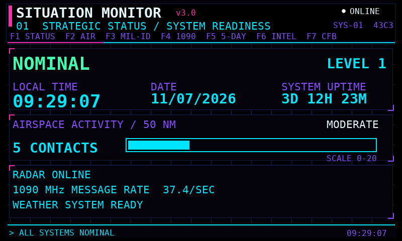
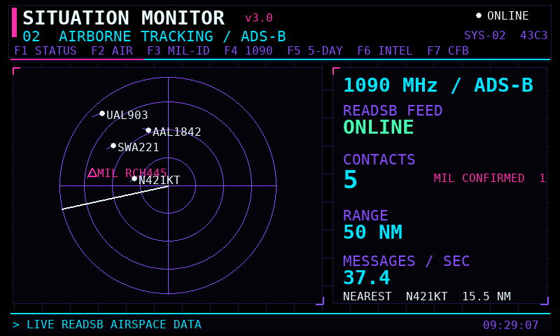
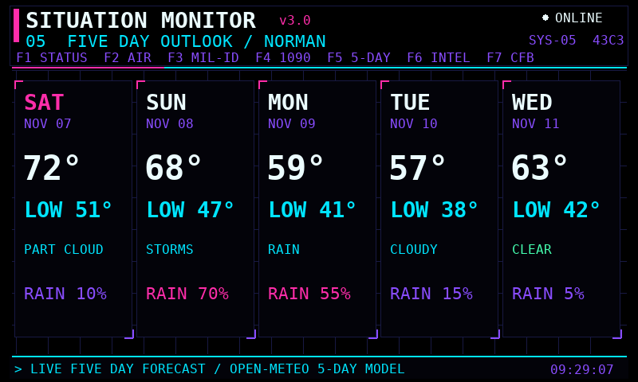
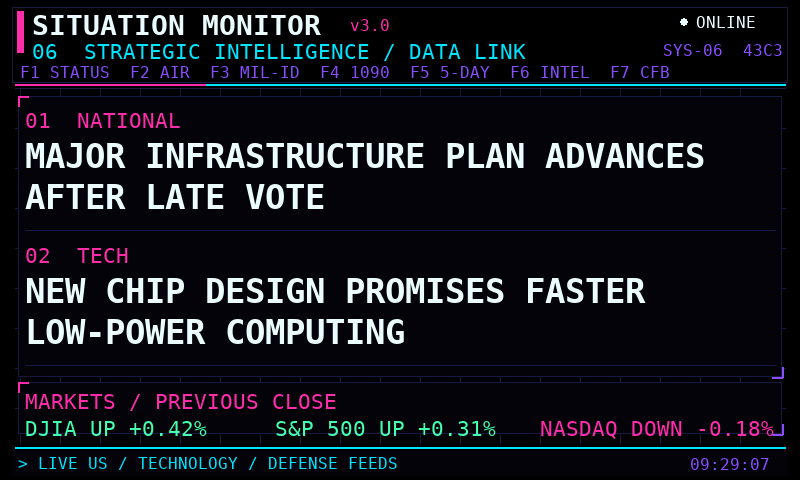
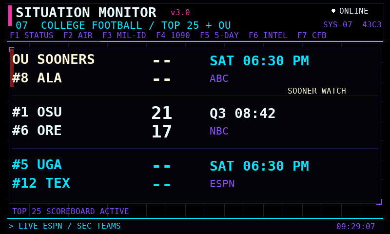

# Situation Monitor v3.0

An always-on, 800 × 480 Raspberry Pi information display built for readability at approximately 10 ft (3 m). Version 3 restores the original rotating-screen format with a true-black background, large text, and a neon cyan, violet, pink, green, and white palette.

It combines a local ADS-B receiver with aircraft tracking, conservative military-aircraft identification, a five-day forecast, current headlines and markets, and an OU-first Top 25 college-football scoreboard.

Despite the historical filename, `SituationMonitor_v2.py` is the current **v3.0** program. The filename is retained so existing Pi launchers continue to work.

## Screens











The screenshots use representative data to demonstrate the layouts. Live installations use their configured location, receiver, feeds, and current scores.

1. **Strategic Status** — local time, uptime, live aircraft count, activity meter, 1090 MHz rate, and feed readiness.
2. **Airborne Tracking** — fixed 50 NM (93 km) ADS-B radar with two-minute trails, military recognition, contact totals, and nearest-track information.
3. **Military Identification** — a large public-reference aircraft profile and wireframe. This page joins rotation only while a recognized military contact is present.
4. **1090 Activity** — recent aircraft, message totals, and a live 60-second activity trace.
5. **Five-Day Outlook** — daily high, low, condition, and maximum precipitation probability using a no-key forecast feed.
6. **Strategic Intelligence** — two large current headlines plus DJIA, S&P 500, and NASDAQ movement.
7. **College Football** — OU appears first whether ranked or not, followed by games involving Top 25 teams. Crowded game days page internally every seven seconds. The screen joins automatic rotation only on relevant game days.

Automatic page rotation is 20 seconds. After a complete rotation, a short pattern-analysis sequence appears before the cycle begins again.

## Requirements

- Raspberry Pi with an 800 × 480 display
- Python 3
- Pygame
- `readsb` providing BaseStation/SBS messages on TCP port 30003
- Internet access for weather, headlines, markets, aircraft metadata, and scores

Install Pygame from Raspberry Pi OS:

```bash
sudo apt update
sudo apt install python3-pygame
```

The ADS-B receiver and `readsb` must be installed separately. By default, the monitor expects the SBS stream at `127.0.0.1:30003`.

## Configuration

Configuration values are near the top of `SituationMonitor_v2.py`:

```python
WIDTH, HEIGHT = 800, 480
PAGE_SECONDS = 20
READSB_HOST, READSB_PORT = "127.0.0.1", 30003
HOME_LAT, HOME_LON = 35.0000, -97.0000
RADAR_RANGE_NM = 50
```

Replace the example coordinates with the installation location. Do not publish precise private coordinates unless that is intentional.

## Running

```bash
python3 SituationMonitor_v2.py
```

For Raspberry Pi OS using Labwc, an autostart entry can launch it after login:

```text
/usr/bin/python3 /home/pi/SituationMonitor_v2.py &
```

The program opens fullscreen and hides the cursor.

## Controls

| Key | Screen |
| --- | --- |
| F1 | Strategic Status |
| F2 | Airborne Tracking |
| F3 | Military Identification, when available |
| F4 | 1090 Activity |
| F5 | Five-Day Outlook |
| F6 | Strategic Intelligence |
| F7 | Top 25 + OU Football |
| F12 | Save a PNG screenshot |
| Escape | Exit during development |

## Data sources and failure handling

- Local `readsb` SBS stream and JSON data for ADS-B
- U.S. National Weather Service for observations and alerts
- Open-Meteo for the five-day forecast and model fallback
- Public RSS feeds for headlines
- Yahoo Finance with a Stooq fallback for market movement
- ESPN scoreboard data for current rankings, schedules, scores, and television coverage

Network work runs in background threads with timeouts. Failed feeds retain last-known data where possible and report stale or unavailable status rather than freezing the display.

## Previous dashboard

The October browser dashboard remains preserved in [`dashboard-v2/`](dashboard-v2/README.md). It is no longer the primary version because its dense single-screen layout was difficult to read at room distance.

## Situation Mirror

[`situation-mirror/`](situation-mirror/README.md) contains the tested lightweight bedroom repeater for an original Raspberry Pi Zero W and a second 800 × 480 display. The main WOPR retains the SDR and network-feed work; the Zero renders a four-page, large-type client from a compact LAN data relay.

## Notes

The military identification page uses publicly available ADS-B information and conservative heuristics. An unknown type receives a generic profile instead of a fabricated identification.

The interface is inspired by retro command terminals but is not affiliated with the creators or rights holders of *WarGames*.
