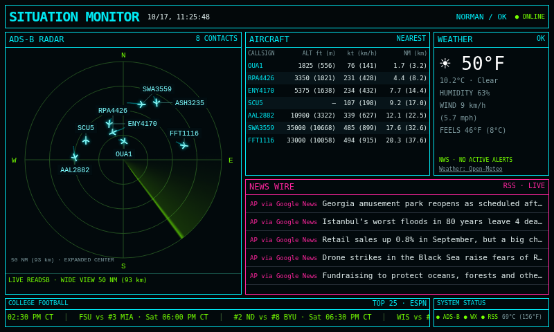

# WOPR Dashboard v2.0.0

A single-screen neon dashboard for the Raspberry Pi Zero 2 W at 800×480. Python 3.9+ standard library server and plain HTML/CSS/JavaScript; no Python packages or browser build required. This version runs separately from the original Pygame application in the repository root.



## Features

- Live local readsb radar with a 50 NM (93 km) radius, bright aircraft markers, separated callsigns, and fading 90-second position trails.
- An expanded-center projection spreads nearby contacts across the display. Bearings are preserved; radial spacing is decorative rather than a uniform distance scale. Table distances remain geographic distances.
- A decorative ten-second radar sweep, with no CRT effects.
- The seven nearest positioned aircraft, with imperial and metric altitude, speed and distance.
- Open-Meteo current weather, plus actual, unexpired NWS alerts for the configured location. Active alerts appear above news; severe/extreme alerts use red, other alerts amber. Feed failures show unavailable/stale rather than an all-clear.
- AP general headlines through Google News RSS, credited and linked to the source. No BBC feed.
- A scrolling ESPN Top 25 college-football ticker on Saturdays and Sundays in America/Chicago time, with OU games highlighted in crimson and cream. Saturday's games remain visible Sunday. Scores refresh each minute; kickoffs, live periods and finals follow provider state.
- Pi temperature, per-feed status, a hidden page cursor, and configurable receiver coordinates.

## Install alongside the original app

The original app and readsb should remain installed. Back up any existing dashboard folder and desktop startup file before changing them.

```sh
git clone https://github.com/wopr-display-lab/wopr-situation-monitor.git
cd wopr-situation-monitor/dashboard-v2
cp config.example.json config.json
nano config.json
python3 server.py
```

Set `latitude` and `longitude` to the receiver's decimal coordinates, `location` to its label, and confirm `readsb_path` (default `/run/readsb/aircraft.json`). A configured `readsb_url` overrides the local path. Coordinates are required for radar, distances, weather and alerts. `range_nm` defaults to 50 NM (93 km).

Open `http://127.0.0.1:8080` in a browser on the Pi at 100% zoom. For access from another device on a trusted LAN, set `host` to `0.0.0.0` and use the Pi's address. There is no authentication; keep the server on your trusted network. Choose a different `port` if 8080 is occupied.

News sources are configurable named RSS/Atom URLs in `rss`. Internet feeds can change or become unavailable; each reports its own state. `markets_path` is a retained optional backend setting; the dashboard's bottom strip now displays football rather than markets.

## Kiosk and boot setup

Run `./launch-kiosk.sh` from the graphical desktop session after the foreground server works. Chromium must be installed. Some Pi OS versions use `chromium-browser`; edit the launcher if needed. The dedicated browser profile avoids interfering with your ordinary browser. Password storage and graphics acceleration are disabled for this kiosk.

The included system service is a template for user `pi` and `/home/pi/wopr-situation-monitor/dashboard-v2`. Change **User**, **WorkingDirectory**, and **ExecStart** if your account or cloned folder differs before installing it. If you change the port, update the launcher URL too.

```sh
sudo cp wopr-dashboard.service /etc/systemd/system/
sudo systemctl daemon-reload
sudo systemctl enable --now wopr-dashboard
```

This starts the server only. To launch the display at login, back up `~/.config/labwc/autostart`, then add the absolute path to `launch-kiosk.sh` followed by `&`. Remove or comment the original display's launch line only after confirming the new dashboard works; keep a copy to restore. Desktop auto-login is configured separately.

### Hide the cursor on labwc

The page uses `cursor:none`. If the compositor keeps an initial cursor onscreen, install `wtype` and add this binding inside the **existing** `<keyboard>` section of your labwc `rc.xml`, preserving its other settings:

```xml
<keybind key="A-W-h">
  <action name="WarpCursor" x="-1" y="-1" />
  <action name="HideCursor" />
</keybind>
```

Back up the configuration first. Use `labwc --reconfigure` from the graphical session, or log out and back in. The launcher invokes the binding after Chromium starts. `HideCursor` is cleared by pointer activity; page CSS also hides the pointer over the dashboard. No complete desktop configuration is supplied or overwritten.

## Verification

```sh
python3 -m unittest -v
```

With Node.js available on a development computer (not required on the Pi):

```sh
node --check static/app.js
node test_client.cjs
```

Seven Python tests cover feed parsing, receiver staleness, distances, cached failure behavior, alert filtering and OU scores. Client checks cover trail limits/expiry and alert states. The dashboard was checked on the target Pi's 800×480 display with live readsb, weather, AP headlines and football. The alert endpoint returned no active local alerts; active/stale/expired alert cases were tested with fixtures. Trails start accumulating after page load and clear if the receiver fails. Reboot behavior has not been verified on the target device.

## Rollback

Stop the new server service and restore the previous desktop autostart backup. Relaunch the original `SituationMonitor_v2.py`; leave readsb running. The original program remains unchanged in the repository root.

## Sources

- Local readsb `aircraft.json` (feed and positions older than 30 seconds rejected)
- [Open-Meteo weather](https://open-meteo.com/) (ten-minute cache)
- [National Weather Service API](https://www.weather.gov/documentation/services-web-api) (one-minute cache)
- AP through Google News RSS (five-minute cache)
- ESPN public college-football scoreboard (one-minute cache; availability is not guaranteed)

The screenshot is a direct capture of the running Pi display. This dashboard is a decorative information display, not an aviation navigation instrument or a substitute for official emergency alerts.
